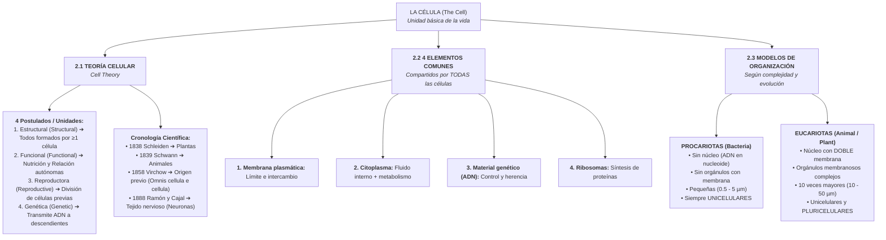

# 🧠 ESQUEMA VISUAL DE ESTUDIO: LA CÉLULA (THE CELL)
## Apartados 2.1 – 2.3 | Biología y Geología 4º ESO (Bilingüe)

---

## 🗺️ 1. Mapa Conceptual Global



---

## ⚡ 2. Resumen Ultra-Sintético (La "Chuleta" para Memorizar)

### 📌 2.1 TEORÍA CELULAR (Cell Theory)
> **Definición clave:** La célula es la unidad **estructural**, **funcional**, **reproductora** y **genética** de los seres vivos.

| Científico (Scientist) | Año | Objeto de estudio | Aportación clave al examen |
| :--- | :---: | :--- | :--- |
| **Matthias Schleiden** | **1838** | Plantas *(Plants)* | Todas las plantas están compuestas de células. |
| **Theodor Schwann** | **1839** | Animales *(Animals)* | Todos los tejidos animales están formados por células. |
| **Rudolf Virchow** | **1858** | Origen celular | *Omnis cellula e cellula*: toda célula viene de otra preexistente. |
| **Santiago Ramón y Cajal** | **1888** | Sistema nervioso | Demostró que el tejido nervioso son células individuales (neuronas). |

> 💡 **Truco mnemotécnico para el orden:**  
> **S**chleiden (Plantas) ➔ **S**chwann (Animales) ➔ **V**irchow (División) ➔ **C**ajal (Neuronas)  
> *Nemotecnia: «**S**olo **S**e **V**iven **C**élulas» (1838 ➔ 1839 ➔ 1858 ➔ 1888)*.

---

### 📌 2.2 COMPONENTES COMUNES A TODAS LAS CÉLULAS
> ⚠️ **Pregunta clásica de trampa de examen:** *«¿Tienen las bacterias ribosomas?»* ➔ **SÍ**.  
> Todas las células de la Tierra (procariotas y eucariotas) tienen **4 elementos obligatorios**:

1. **Membrana plasmática (Plasma membrane):** Bicapa lipídica que encierra la célula y regula entradas/salidas.
2. **Citoplasma (Cytoplasm):** Medio acuoso donde ocurren las reacciones metabólicas vitales.
3. **Material genético (Genetic material - ADN):** Contiene la información hereditaria.
4. **Ribosomas (Ribosomes):** Complejos de ARN + proteínas que fabrican proteínas.

---

### 📌 2.3 PROCARIOTAS vs. EUCARIOTAS (Tabla Comparativa Definitiva)

| Característica | PROCARIOTA *(Bacteria)* | EUCARIOTA *(Animal / Vegetal)* |
| :--- | :--- | :--- |
| **Núcleo (Nucleus)** | ❌ **NO tiene**. ADN disperso en el *nucleoide*. |  **SÍ tiene**. Rodeado por **doble membrana**. |
| **Orgánulos con membrana** | ❌ **NO tiene**. Solo ribosomas. |  **SÍ tiene** (mitocondrias, RE, Golgi, vacuolas...). |
| **Tamaño (Size)** |  **0,5 a 5 µm** (muy pequeñas). |  **10 a 50 µm** (*más de 10 veces mayor*). |
| **Nivel de organización** |  **Solo unicelulares**. Jamás forman tejidos. |  **Unicelulares y pluricelulares**. |
| **Representantes** | Bacterias y Arqueas. | Animales, plantas, hongos, protozoos. |

---

### 📌 CÉLULAS ESPECIALIZADAS: FORMA Y FUNCIÓN (Shape & Function)
En organismos pluricelulares, la **forma de la célula depende de su trabajo**:

```
 ┌───────────────────────────┬────────────────────────────┬───────────────────────────────────────┐
 │ Célula                    │ Forma en inglés / español  │ Función biológica                     │
 ├───────────────────────────┼────────────────────────────┼───────────────────────────────────────┤
 │  Célula muscular         │ Elongated (Alargada)       │ Contracción y movimiento tisular      │
 │ ⚡ Célula nerviosa        │ Branch out (Ramificada)    │ Transmitir impulsos eléctricos a dist.│
 │ 🌱 Célula vegetal          │ Polyhedral (Poliédrica)    │ Soporte rígido y fotosíntesis (autótr)│
 └───────────────────────────┴────────────────────────────┴───────────────────────────────────────┘
```

* **Nutrición Heterótrofa (Animales):** No producen su propio alimento; se nutren de materia orgánica externa.
* **Nutrición Autótrofa (Plantas):** Fabrican su propia materia orgánica a partir de luz y CO₂ (fotosíntesis).

---

## 🎯 3. Las 5 Preguntas Típicas de Examen

1. **¿Qué significa *omnis cellula e cellula* y quién lo propuso?**  
   * *Respuesta:* Significa que toda célula procede de la división de otra célula preexistente. Lo demostró Rudolf Virchow en 1858.
2. **¿Por qué fue crucial el trabajo de Ramón y Cajal para la teoría celular?**  
   * *Respuesta:* Porque el tejido nervioso parecía una red continua (reticular); Cajal demostró que estaba formado por células individuales (neuronas), universalizando la teoría a todos los tejidos conocidos.
3. **Menciona los 4 componentes que comparte una bacteria con una neurona humana:**  
   * *Respuesta:* Membrana plasmática, citoplasma, material genético (ADN) y ribosomas.
4. **¿Cuál es la diferencia principal entre el material genético de un procariota y un eucariota?**  
   * *Respuesta:* En el procariota está libre en el citoplasma (nucleoide) sin envoltura; en el eucariota está encerrado dentro de un núcleo con doble membrana nuclear.
5. **Relaciona la forma de la célula muscular y de la neurona con su función:**  
   * *Respuesta:* La célula muscular es alargada (*elongated*) para permitir el acortamiento mecánico durante la contracción; la neurona es ramificada (*branched*) para conectar con múltiples células y transmitir señales a distancia.
